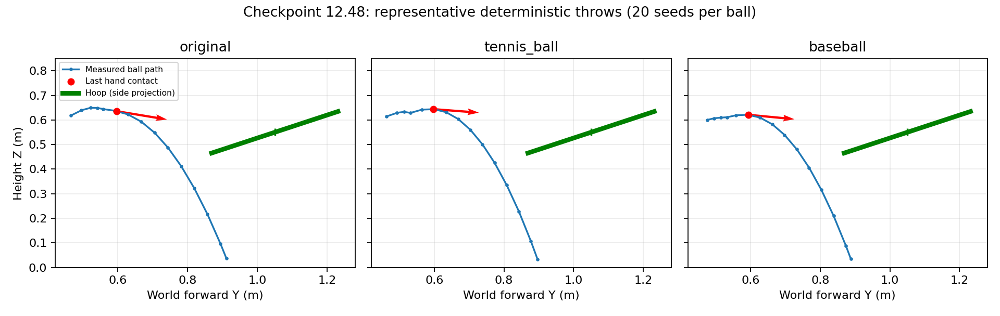

# 三球12.48模型诊断（2026-11-02）

权重：`/home/isee/Catch/11-2/throw_basket_catch_best_reward_12.48.pth`。
保存信息：589824 agent steps，source kind=scratch，无参考网络，35维归一化统计计数587777，新物理输入为半径/质量，共37维。

每种球用固定种子1000..1019测试20回合确定性均值动作，再用相同种子各测试20回合训练式随机动作采样，共120回合。CPU、无Viewer、底座固定、同一三球配置，重置与物理协议校验通过。没有训练或优化器更新。

| 球 | 均值动作投进 | 随机动作投进 | 两种模式有效抛出 |
|---|---:|---:|---:|
| 原始球 | 0/20 | 0/20 | 40/40 |
| 网球 | 0/20 | 0/20 | 40/40 |
| 棒球 | 0/20 | 1/20 | 40/40 |

随机动作棒球1次成功不能解释为稳定5%成功率，样本少，且与稳定均值策略不同。

## 均值动作的出手与弹道

| 球 | 平均前向速度m/s | 平均竖直速度m/s | 释放时刻s | 释放高度m | 预测框平面误差m | 预测穿过平面时Y比框心短m |
|---|---:|---:|---:|---:|---:|---:|
| 原始球 | 0.906 | +0.099 | 0.196 | 0.647 | 0.303 | 0.267 |
| 网球 | 0.935 | -0.079 | 0.218 | 0.624 | 0.322 | 0.288 |
| 棒球 | 0.838 | -0.086 | 0.256 | 0.617 | 0.329 | 0.297 |

这里的平面误差和Y偏差是基于最后接触位置/速度的重力弹道预测，不是实测命中点。实际60个均值动作回合全部结束于ball_on_floor。释放及飞行均被判定有效，没有危险机器人碰撞奖励。

主要瓶颈是射程/释放速度组合不足，尤其上抛速度不足，网球和棒球平均略向下；不是大量初始化失败或未抛出。不能仅凭这些数据断言物理参数输入完全未被利用。

轨迹图每球取预测误差中位数附近回合，蓝线是策略采样时刻的实测球心位置，红点是最后手接触位置，绿线为框口侧视投影。

## 为什么奖励仍有12左右

均值动作平均奖励约15.86/16.55/16.22，随机采样约11.72/12.57/13.69，与训练日志接近。

均值动作获得有效抛出+5、飞行推进约+2.8..3.3、瞄准约+1.9..2.4，另有机械臂前送及保持位置/释放等奖励。即使没有真实投进，仍能获得十多分。机械臂前送平均约5.4/5.8/6.8cm，说明前送确实学到了一部分，但没有形成足够的球出手速度。

120回合中有效抛出均已确认，原奖励的failure项均为0（该项只惩罚未确认有效抛出），均值动作basket_hit项均为0。当前奖励结构存在让“前送后短抛”成为易获得回报的局部解的风险；这是一项结合代码与测量的诊断推断，不是证明训练继续进行一定无法突破。

动作探索标准差多数仍约0.95..1.00（归一化动作空间），因此训练采样比均值策略更不稳定，但均值策略自身也未命中，不能仅靠关闭随机探索解决。

## 下一版建议

保持用户要求的从零训练、三球等概率，不使用旧模型：

- 把奖励引导重点放在能到达框口的完整弹道上，增加持球加速阶段有界的弹道质量进展引导。
- 独立的前送距离奖励应减少或与弹道质量关联，避免慢慢送够6cm也获得大量信用。
- 为有效抛出但最终未投进的回合设置适度失败成本，同时维持真实投进最高收益、安全判定不变。
- 补充各球有效释放率、弹道误差、各奖励分项及实际actor更新次数；再依据数据决定KL保护是否需调整，不能仅根据日志经常接近0.01就直接放宽。

这些奖励/训练策略修改尚未实施；本轮完成的是评估与诊断。

## 加载兼容修正

实际权重中的training_metrics含NumPy标量，当前本机PyTorch默认的weights-only读取拒绝加载。已在三球训练器的源权重和测试权重加载处显式使用`weights_only=False`，用于用户自己提供的训练权重；文件、奖励与模型参数没有被修改。此修正使实际12.48权重能正常加载。

原始逐回合信息、轨迹、候选释放状态和奖励分项分别保存在original.json、tennis_ball.json、baseball.json；summary.json为汇总，evaluate.py及summarize.py为复现脚本。
