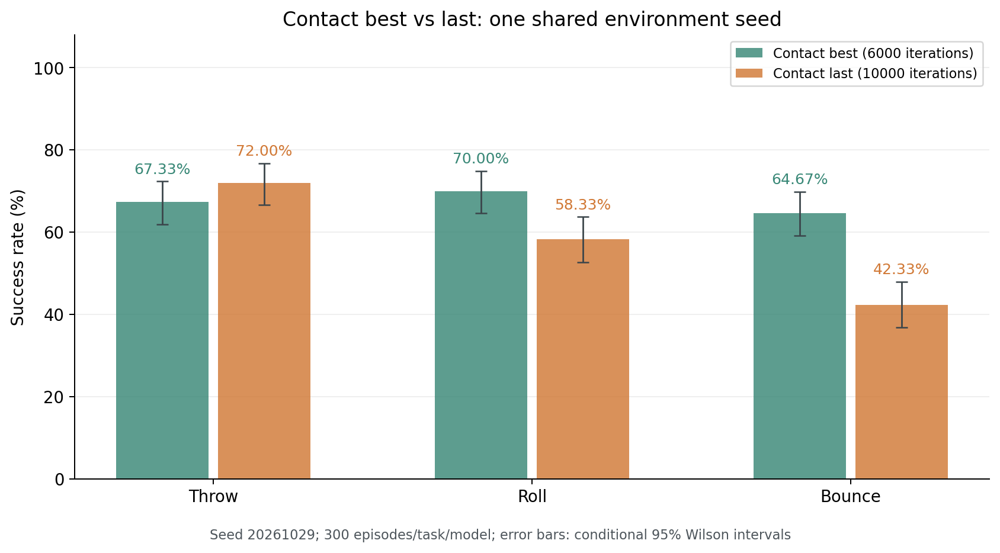

# Contact best 与 last 单种子评估（2026-10-30）

**完整评估：1800回合。** 两模型分别在Throw、Roll、Bounce测试300回合；共用环境种子20261029。

`student_best.pth` 是Contact第6000轮，`student_last.pth` 是同结构Contact第10000轮。按原训练best选择口径“三任务最差成功率”比较，本次是 **best（6000轮）较高**；按三任务平均比较，**best（6000轮）较高**。两种口径须分别看待。

这是一个环境种子下两份具体权重的条件对照，不能据此判断跨环境种子、跨训练种子的稳定优劣。文件名best反映原训练评估的选择结果，并不保证在新的环境种子下始终胜出。

## 三项任务成功率

|任务|best 6000 成功/回合|best 成功率及条件95% Wilson区间|last 10000 成功/回合|last 成功率及条件95% Wilson区间|last−best（百分点）|
|---|---:|---|---:|---|---:|
|Throw|202/300|67.33% [61.84%, 72.39%]|216/300|72.00% [66.67%, 76.78%]|+4.67|
|Roll|210/300|70.00% [64.59%, 74.91%]|175/300|58.33% [52.68%, 63.77%]|-11.67|
|Bounce|194/300|64.67% [59.10%, 69.86%]|127/300|42.33% [36.87%, 47.99%]|-22.33|

|模型|三任务成功总数/900|三任务等权平均|最差任务成功率|最差任务|
|---|---:|---:|---:|---|
|Contact best 6000轮|606/900|67.33%|64.67%|Bounce|
|Contact last 10000轮|518/900|57.56%|42.33%|Bounce|

三任务平均差值（last−best）为 **-9.78个百分点**；最差任务成功率差值为 **-22.33个百分点**。本次两模型最低成功率对应的任务相同：Bounce。

每项任务的Wilson区间仅近似反映固定当前采样环境参数后的回合抽样误差；同一构造种子下球的半径、质量等可能固定，不是300组独立物理参数。只有一个环境种子，本报告不计算环境种子层面的t区间，也不把900回合混合区间当作跨任务泛化区间。

## 同一初始状态下的配对成败

仅对种子、回合编号及捕获的初始物理哈希一致的回合比较。差值方向为last−best；last单独成功数多于best单独成功数时，匹配子集中的last成功率较高。

|任务|物理匹配/共同编号|初始深度逐位一致|双方成功|双方失败|仅best成功|仅last成功|配对差值（百分点）|运行库版本一致|
|---|---:|---:|---:|---:|---:|---:|---:|---|
|Throw|300/300|236/300|161|43|41|55|+4.67|是|
|Roll|300/300|300/300|123|38|87|52|-11.67|是|
|Bounce|300/300|300/300|95|74|99|32|-22.33|是|

物理一致不代表深度浮点数组逐位一致。图像一致子集的成败列联表和差值、所有不匹配编号、运行库版本保存在summary.json。图像一致子集可能存在选择偏差，不替代全部正式回合。若存在物理不匹配，配对差值只描述匹配子集，可能不同于上方全部300回合的原始成功率差。

配对discordant counts（仅一方成功的数量）用于展示这300回合的具体胜负，不代表不同环境参数下的重复证据；不把本次一个seed的差值解释成普遍优势。

## Roll 的区域保持与稳定抓持

Roll主指标为 `roll_eval_success / region_retention_v5`，与 `roll_stable_hold` 是不同判据。区域保持成功不能直接当作可靠的稳定抓球成功。

|模型|指标|成功/已报告回合|比例|
|---|---|---:|---:|
|best 6000轮|success|0/300|0.00%|
|best 6000轮|roll_eval_success|210/300|70.00%|
|best 6000轮|roll_caught_once|272/300|90.67%|
|best 6000轮|roll_stable_hold|4/300|1.33%|
|best 6000轮|roll_holding_at_end|216/300|72.00%|
|best 6000轮|roll_final_hold|216/300|72.00%|
|best 6000轮|roll_legacy_success|0/300|0.00%|
|last 10000轮|success|0/300|0.00%|
|last 10000轮|roll_eval_success|175/300|58.33%|
|last 10000轮|roll_caught_once|282/300|94.00%|
|last 10000轮|roll_stable_hold|1/300|0.33%|
|last 10000轮|roll_holding_at_end|183/300|61.00%|
|last 10000轮|roll_final_hold|183/300|61.00%|
|last 10000轮|roll_legacy_success|0/300|0.00%|

|任务|模型|本次记录的半径集合（米）|质量集合（千克）|
|---|---|---|---|
|Throw|best|0.042531|0.035000|
|Throw|last|0.042531|0.035000|
|Roll|best|0.042300|0.179038|
|Roll|last|0.042300|0.179038|
|Bounce|best|0.040000|0.050000|
|Bounce|last|0.040000|0.050000|

## 文件、协议与评估边界

- best：`/home/isee/Catch/student_best.pth`，iteration=6000，SHA256 `381bb98d3605b0396f8cffa025900171da23cbed05d425bf3a0c1f239d42bec3`。
  源清单哈希一致 284/284，另核验 57 个历史资源。
- last：`/home/isee/Catch/student_last.pth`，iteration=10000，SHA256 `b520de40e69fc4ef79ef522f5caa27f3dda9ffda912723ffc8344f48eaa2ce8b`。
  源清单哈希一致 284/284，另核验 57 个历史资源。

使用独立历史源码、原网络、归一化器、动作适配、两路深度与原任务判定；策略推理batch为1。没有重新训练或更改权重，仿真物体真值不进入策略。原worker逐回合重新设定随机种子，本次以实际初始状态哈希核验配对。

任务判据：Throw = `success / throw_official`；Roll = `roll_eval_success / region_retention_v5`；Bounce = `success / bounce_catch_proximity_v2`。本次不是新YCB目标泛化、实机测试或跨训练seed的算法排名。

先前已停止的5组种子Contact测试、旧300回合导出、其他模型评估、试跑均不计入这1800回合。完整输入哈希、终止原因、条件区间和配对记录见 [summary.json](summary.json)。

