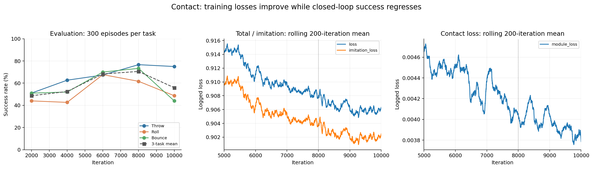

# Contact 后期训练退化分析（2026-10-31）

可确认的现象是：训练代理损失继续缓慢下降，但闭环成功率下降。没有日志证据显示损失数值发散；现有数据尚不能把退化归因于某一个模块或确定为传统意义的过拟合。

## 全部评估点

|轮次|Throw|Roll|Bounce|三任务平均|最低任务成功率|
|---:|---:|---:|---:|---:|---:|
|2000|51.00%|44.00%|51.00%|48.67%|44.00%|
|4000|62.67%|42.67%|52.00%|52.44%|42.67%|
|6000|67.33%|67.67%|70.00%|68.33%|67.33%|
|8000|76.67%|61.67%|73.33%|70.56%|61.67%|
|10000|75.00%|48.67%|44.00%|55.89%|44.00%|

6000轮的最弱任务成功率最高，因此student_best保存在6000轮；8000轮的三任务平均最高；10000轮是last，不能代表峰值表现。

## 训练损失没有随成功率一起恶化

下面对比评估前200轮的平均值，避免用单轮随机波动判断趋势。训练数据来自不断变化的在线回放，这不是固定验证集上的误差。

|指标|7801–8000平均|9801–10000平均|
|---|---:|---:|
|loss|0.90787000|0.90632763|
|imitation_loss|0.90377177|0.90249954|
|position_loss|0.00047035|0.00042665|
|velocity_loss|0.02511328|0.02411283|
|module_loss|0.00405119|0.00378543|

10000个唯一轮次的所有已记录损失均有限；总损失、模仿损失和Contact模块损失的窗口均值都略有下降。不能用这些指标宣称闭环能力持续改善，也没有证据把这次下降称为loss爆炸。速度辅助权重为0，日志中的velocity_loss未参与加权训练目标。

## 后期更新强度和回放窗口

- 学习率配置为3e-4，训练实现没有学习率调度器。
- 8000到10000轮又执行2000×8＝16000次optimizer.step；每任务计划采样2000×8×64＝1024000个环境控制步。
- 每任务回放容量8192帧，每轮计划新增8×64＝512帧，容量约为16轮采样量。实际淘汰按完整回合进行，这只是量级估算。
- 因而训练一直拟合近期策略产生的轨迹，8000轮附近的旧轨迹不会长期保留。策略漂移、旧行为被覆盖是有实现依据的候选机制，尚未通过对照实验确认。
- Contact预测通过缩放/平移直接调制动作头特征；接触分类损失下降不保证保持球的动作更好。日志没有各任务动作误差、接触正负样本比例、预测准确率或梯度分解，无法证明模块本身是根因。

## Roll和Bounce的具体退化

|Roll诊断|8000轮|10000轮|
|---|---:|---:|
|roll_caught_once|271|277|
|roll_holding_at_end|190|153|
|roll_stable_hold|0|0|
|below_palm|92|134|

曾进入保持区域的次数未下降，但结束时保持住球的次数减少，球落到手掌下方的回合增加。这里是region_retention_v5区域保持，不能等同于严格稳定抓持。
Bounce的ball_left失败从80次增加到168次。

## 续训与文件一致性

metrics共有10497行，唯一轮次为1–10000。多出的497行是早期重复轮次；本分析按每个轮次最后一次记录构造曲线，没有改原日志。可识别的回退如下：

|日志行|上一轮|回退后的第一轮|
|---:|---:|---:|
|2198|2197|2001|
|2525|2327|2201|
|2698|2373|2201|

8000–10000轮编号连续，没有类似回退记录；这不能排除恰好从最新保存点继续的重启。resume_audit记录接受了41个源码路径变化，old_config与new_config完全相同。该审计未记录续训起点轮次和时间，不能据此定位后期退化。
现存best（6000）与last（10000）的配置、教师哈希、源码清单哈希均相同，权重全部有限。检查点中的源码清单是在训练入口建立的，不是逐轮实时追踪磁盘修改。
五份评估JSON中可见的种子、相机、任务判据及评估版本一致；8000轮没有对应的已保存权重或独立源码审计，因此无法仅凭这些文件完全证明所有运行条件相同。

resume_last.pth在首次检查时仍在复制，文件大小持续增长，因而当时的读取失败不能当作训练损坏的证据。

复制完成后已使用torch.load（CPU、weights_only=True）成功读取完整resume：iteration=10000；Adam参数组学习率=0.0003；累计step=[80000.0]；网络权重、配置和元数据均与student_last相同。best_score=0.6733333333333333，与6000轮最弱任务成功率一致。

|任务|回放回合数|回放帧数|物体—手部接触帧比例|
|---|---:|---:|---:|
|Throw|143|8160|40.45%|
|Roll|134|8154|18.81%|
|Bounce|142|8176|48.10%|

Bounce末态回放中约48%的帧有物体—手部接触，三个接触预测目标的正样本比例约52%、47%、43%。因此，末态数据并非几乎没有接触正样本；但这些是标签统计，不等同于预测准确率。该回放来自训练采样环境，与seed=123的单环境评估也不是同一组轨迹。完整末态核验见[resume_inspection.json](resume_inspection.json)。

## 现阶段的结论与后续检查

优先保留现有student_best（6000轮）；8000轮评估也值得保留，但此目录仅有eval_008000.json，没有8000轮权重，不能从评估JSON恢复模型。
目前更准确的诊断是“近期数据上的代理损失与闭环性能脱节”，而不是已经证明过拟合、灾难性遗忘或Contact模块有bug。后续实验优先检查后期学习率衰减、近期回放对旧成功轨迹的覆盖，以及Contact预测调制前后的动作差；一次只改变一个因素。
如要严格定位，需固定回放验证集并分任务记录动作误差、接触分类的正负样本比例与准确率，或对同一检查点关闭Contact调制做独立诊断。上述实验本次均未运行。

完整数值、输入文件SHA256和检查点核验见[summary.json](summary.json)。