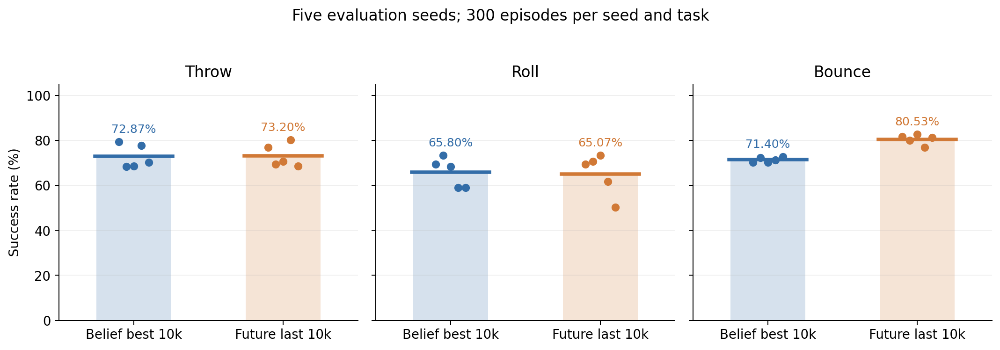
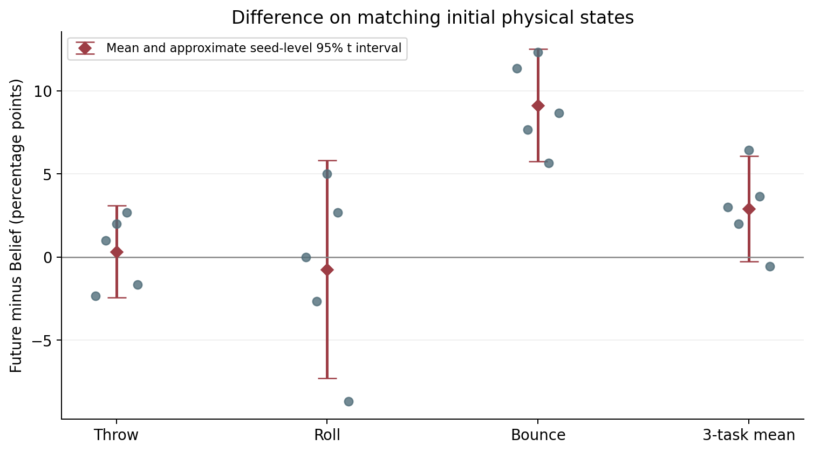

# Belief 与 Future 多种子重复评估（2026-10-29）

状态：完整；已统计 9000/9000 回合。

本次比较 **Belief student_best（10000轮）** 与 **Future student_last（10000轮）**。Future student_best 是6000轮；本次没有将它混入一万轮对比。

每模型、每任务使用5个新的评估种子，每种子300回合，共1500回合；两个模型、三个任务共9000回合。它们是5组环境随机种子，两个已训练好的策略各只有一份，不代表5次独立训练。

Bounce的Future−Belief差值为+9.13个百分点，5组中有5组Future较高；Throw和Roll差值分别为+0.33、-0.73个百分点。三任务平均差值为+2.91个百分点，种子层面的平均差值区间仍跨0，不能据此断言综合优势稳定。

面向实机时尤其需要区分Roll的成功口径：主成功率是区域保持，严格的稳定抓持为Belief 5/1500、Future 3/1500。主指标不能直接代表可靠的稳定抓球能力。

## 成功率

|任务|模型|成功/回合|成功率|回合级95% Wilson区间|5种子最小–最大|种子间标准差|
|---|---|---:|---:|---|---|---:|
|Throw|Belief best (10k)|1093/1500|72.87%|[70.56%, 75.06%]|68.33%–79.33%|5.23%|
|Throw|Future last (10k)|1098/1500|73.20%|[70.90%, 75.38%]|68.67%–80.33%|5.18%|
|Roll|Belief best (10k)|987/1500|65.80%|[63.36%, 68.16%]|59.00%–73.33%|6.48%|
|Roll|Future last (10k)|976/1500|65.07%|[62.62%, 67.44%]|50.33%–73.33%|9.31%|
|Bounce|Belief best (10k)|1071/1500|71.40%|[69.06%, 73.63%]|70.33%–72.67%|1.09%|
|Bounce|Future last (10k)|1208/1500|80.53%|[78.45%, 82.46%]|77.00%–82.67%|2.19%|

三个任务等权平均：

|模型|平均成功率|5种子平均值的近似95% t区间|
|---|---:|---|
|Belief best (10k)|70.02%|[67.31%, 72.74%]|
|Future last (10k)|72.93%|[68.36%, 77.51%]|

Wilson区间只近似反映固定这5组环境之后的回合抽样误差，不能把1500回合视作1500次独立的环境参数抽样。种子间差异和下方种子层面的区间更适合检查对环境变化的敏感度。只有5个种子，t区间依赖近似假设，应作描述性参考。

## 同一初始物理状态的模型差异

差值统一为 **Future − Belief**，单位是百分点；正值表示Future较高。配对只使用种子、回合编号相同且初始物理哈希一致的回合。

|任务|物理配对/共同编号|初始深度逐位一致|配对差值（种子等权）|5种子差值的近似95% t区间|
|---|---:|---:|---:|---|
|Throw|1500/1500|1239/1500|+0.33|[-2.43, +3.09]|
|Roll|1500/1500|1500/1500|-0.73|[-7.29, +5.83]|
|Bounce|1500/1500|1500/1500|+9.13|[+5.76, +12.50]|
|三任务平均|—|—|+2.91|[-0.25, +6.07]|

初始物理哈希和初始渲染深度哈希分别核对。物理一致并不保证图像浮点数组逐位一致；有图像差异时，不能把该回合称作完全相同的视觉输入。完整深度也相同的子集结果及所有不匹配编号保存在 summary.json。图像一致子集是敏感性检查，不替代全部正式回合。

若差值区间跨0，当前5个环境种子无法支持稳定的优劣结论；即使区间不跨0，也不能据此推断不同训练随机种子下的算法整体优劣。

## 每个评估种子的结果

|任务|评估种子|Belief 成功率|Future 成功率|物理配对差值（百分点）|
|---|---:|---:|---:|---:|
|Throw|20261029|79.33%|77.00%|-2.33|
|Throw|20262029|68.33%|69.33%|+1.00|
|Throw|20263029|68.67%|70.67%|+2.00|
|Throw|20264029|77.67%|80.33%|+2.67|
|Throw|20265029|70.33%|68.67%|-1.67|
|Roll|20261029|69.33%|69.33%|+0.00|
|Roll|20262029|73.33%|70.67%|-2.67|
|Roll|20263029|68.33%|73.33%|+5.00|
|Roll|20264029|59.00%|61.67%|+2.67|
|Roll|20265029|59.00%|50.33%|-8.67|
|Bounce|20261029|70.33%|81.67%|+11.33|
|Bounce|20262029|72.33%|80.00%|+7.67|
|Bounce|20263029|70.33%|82.67%|+12.33|
|Bounce|20264029|71.33%|77.00%|+5.67|
|Bounce|20265029|72.67%|81.33%|+8.67|

## Roll口径与物体参数

主成功率使用原模型配置的 roll_eval_success / region_retention_v5。它与“稳定抓持”是两个指标；区域保持成功不能直接写成稳定抓住球。

|模型|指标|成功/已报告回合|比例|
|---|---|---:|---:|
|Belief best (10k)|success|0/1500|0.00%|
|Belief best (10k)|roll_eval_success|987/1500|65.80%|
|Belief best (10k)|roll_caught_once|1318/1500|87.87%|
|Belief best (10k)|roll_stable_hold|5/1500|0.33%|
|Belief best (10k)|roll_holding_at_end|1006/1500|67.07%|
|Belief best (10k)|roll_final_hold|1006/1500|67.07%|
|Belief best (10k)|roll_legacy_success|0/1500|0.00%|
|Future last (10k)|success|0/1500|0.00%|
|Future last (10k)|roll_eval_success|976/1500|65.07%|
|Future last (10k)|roll_caught_once|1411/1500|94.07%|
|Future last (10k)|roll_stable_hold|3/1500|0.20%|
|Future last (10k)|roll_holding_at_end|1011/1500|67.40%|
|Future last (10k)|roll_final_hold|1011/1500|67.40%|
|Future last (10k)|roll_legacy_success|0/1500|0.00%|

Roll物体半径、质量按环境构造时的种子抽样；下面列出每个种子实际记录到的参数集合，便于确认同一环境内是否固定。

|模型|种子|半径（米）|质量（千克）|
|---|---:|---|---|
|Belief best (10k)|20261029|0.042300|0.179038|
|Belief best (10k)|20262029|0.049900|0.170143|
|Belief best (10k)|20263029|0.049600|0.112215|
|Belief best (10k)|20264029|0.032600|0.148178|
|Belief best (10k)|20265029|0.031400|0.192609|
|Future last (10k)|20261029|0.042300|0.179038|
|Future last (10k)|20262029|0.049900|0.170143|
|Future last (10k)|20263029|0.049600|0.112215|
|Future last (10k)|20264029|0.032600|0.148178|
|Future last (10k)|20265029|0.031400|0.192609|

## 复现、源码与限制

评估使用独立恢复的历史源码目录，沿用原网络、归一化器、动作适配、摄像头和各任务成功定义；没有重新训练或更改权重。环境可以并行运行，每次策略前向计算的batch固定为1，避免批量形状引起微小浮点差异后放大为不同闭环结果。短测和废弃批量试跑的数据没有计入本报告。

原worker每回合显式重新设定种子，构造种子为 evaluation_seed + 1000000 + TASK_ID×10000，回合种子再加 episode_index×100003。因此，先前若将“终止时间不同消耗随机数”作为无法配对初始状态的直接原因，这一说法需要更正。本次根据实际初始物理哈希核验配对；旧导出没有这些哈希，不能反推其逐回合完全一致。

- Belief best (10k)：`belief_student_best.pth`，iteration=10000；SHA256 `83a6a4f0ba6c72fcc983464dc8051ede940ff26cd71f494409527cc7b4e02888`。
  原清单源码文件 284/284 哈希一致，另补充 57 个经历史git版本逐字节核验的资源文件。
- Future last (10k)：`future_student_last.pth`，iteration=10000；SHA256 `d0d789a03ae850995f5e7ba524754518afa6891802f3882d8b475dd92c312ae6`。
  原清单源码文件 253/254 哈希一致，另补充 57 个经历史git版本逐字节核验的资源文件。
  例外：`model_experiments/run.py` 未能恢复原文件；独立目录中放置了导入即报错的占位文件，评估同时断言它未被导入。该文件是未使用的训练启动器，不能将整个Future清单描述为全部原样恢复。

任务定义：Throw = success / throw_official；Roll = roll_eval_success / region_retention_v5；Bounce = success / bounce_catch_proximity_v2。当前本地运行库与原服务器可能不同，故本次是同一本地评估条件下的模型对比，不能保证复现旧300回合的逐回合轨迹或百分比。

旧300回合不与新1500回合合并。此次也没有评估真实机器人、新YCB物体泛化或不同训练随机种子的方差。

输入哈希、每种子统计、成败配对列联表和初始状态不匹配编号见 [summary.json](summary.json)。图中的点是每种子300回合的成功率，柱/粗线表示等权平均。

## 独立初始图像检查

正式测试后另取Throw seed=20261029、每模型5回合保存原始策略输入，未加入9000回合统计。物理哈希一致5/5，深度逐位一致4/5。
5幅top图像共128000个像素，其中160个不同；编码最大绝对差0.000244140625，按相机范围换算为裁剪、量化后的深度最大差约1.20毫米。wrist不同像素为0。这只是小样本诊断，不能替代全部不匹配图像的测量，也不能单凭差值小就断定对闭环成功没有影响。
完整诊断和逐回合NPZ见 [图像检查报告](../depth_diagnostic/REPORT.md)。
