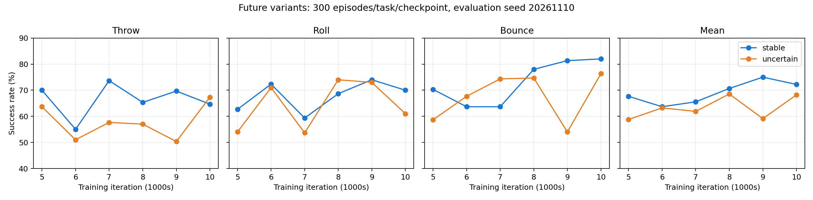

# Future variants analysis — 2026-11-16

每个检查点评估每任务300回合，固定评估种子20261110。此报告读取已有结果，没有启动模拟。

|版本|轮次|Throw|Roll|Bounce|平均|最低任务|
|---|---:|---:|---:|---:|---:|---:|
|stable|5000|70.00%|62.67%|70.33%|67.67%|62.67%|
|stable|6000|55.00%|72.33%|63.67%|63.67%|55.00%|
|stable|7000|73.67%|59.33%|63.67%|65.56%|59.33%|
|stable|8000|65.33%|68.67%|78.00%|70.67%|65.33%|
|stable|9000|69.67%|74.00%|81.33%|75.00%|69.67%|
|stable|10000|64.67%|70.00%|82.00%|72.22%|64.67%|
|uncertain|5000|63.67%|54.00%|58.67%|58.78%|54.00%|
|uncertain|6000|51.00%|71.00%|67.67%|63.22%|51.00%|
|uncertain|7000|57.67%|53.67%|74.33%|61.89%|53.67%|
|uncertain|8000|57.00%|74.00%|74.67%|68.56%|57.00%|
|uncertain|9000|50.33%|73.00%|54.00%|59.11%|50.33%|
|uncertain|10000|67.33%|61.00%|76.33%|68.22%|61.00%|

## 模型选择

- Stable: student_best=9000轮，平均75.00%，最低69.67%；last=10000轮，平均72.22%，最低64.67%。
- Uncertain: student_best和last均为10000轮，平均68.22%，最低61.00%。8000轮平均68.56%略高，但最低任务只有57%。
- Best按三个任务最低成功率选择，而非平均成功率。

## 解释与限制

- 稳定版9000→10000：Throw下降5.00个百分点、Roll下降4.00、Bounce上升0.67。不存在所有任务同步改善。
- 不确定性版8000→9000：Bounce下降20.67个百分点，10000恢复到76.33%，是波动而非单调退化。
- 两组公共源码hash一致；配置主要不同为架构及学习率策略。每组只有一个训练种子，不能将差异单独归因于学习率或不确定性。
- 不确定性版负NLL可为负，总loss不能与稳定版SmoothL1直接比较。
- 最后一轮的replay训练批诊断：增强版预测RMSE更低并不表示闭环控制更好；不同策略采集的状态分布也不同。
- 原Future多种子1500回合结果：Throw73.20%、Roll65.07%、Bounce80.53%、平均72.93%。与当前300回合不同协议，不能据此宣布稳定版显著超过原版。
- 300回合在这些成功率附近单任务95%抽样误差量级约±4–6个百分点；固定验证集被重复用于选模型，后续应使用新种子独立复测。
- 同一种子不等于已经核实逐回合初始状态完全一致；本次旧JSON无初始状态hash，不计算严格配对显著性。
- Roll仍采用接触后区域保留成功标准，并非稳定抓握。

下一步优先独立复测Stable的9000与10000轮及原Future10000轮，保持相同环境、种子、并行数量、推理batch和成功判据。

