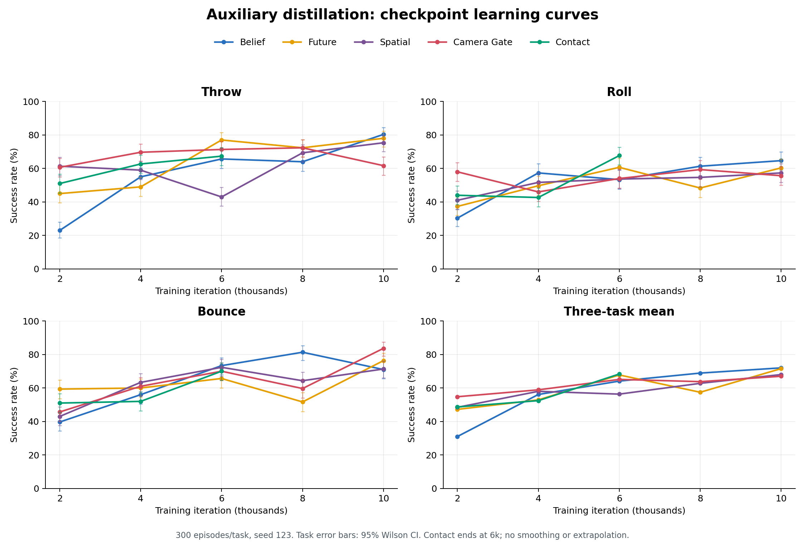
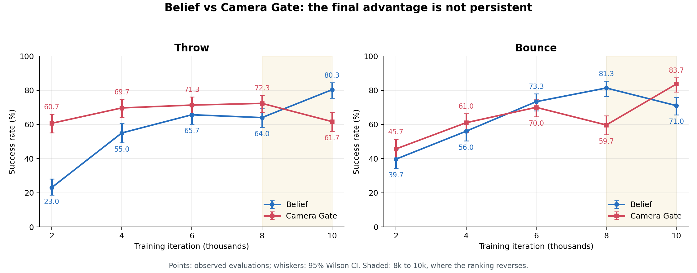

# 2000～10000轮：五组视觉辅助蒸馏曲线分析

日期：2026-10-29。

已核对23份JSON、20700个逐回合记录。原始文件未修改。四组有5个评估点，Contact仅有2000/4000/6000。
所有文件的可见条件相同：Catch视觉学生、seed=123、每任务300回合、Top/Wrist双深度160×160，
success metric/definition、evaluation_revision、camera完整字典均一致。五个末点与之前eval_export中的内容相同。

## 关键结论：最终点的优势不是持续优势

Camera Gate在前四个Throw评估点都高于Belief，仅到10000轮反转。Bounce领先关系也发生明显反转。
因此，先前“Belief可能更适合Throw、门控可能更适合Bounce”的解释仍只能作为机制假设；
这些曲线不支持把最终轮优势直接推广成架构的固定特长。

| 轮次 | Belief Throw | Gate Throw | Belief Bounce | Gate Bounce |
|---|---:|---:|---:|---:|
| 2000 | 23.00% | 60.67% | 39.67% | 45.67% |
| 4000 | 55.00% | 69.67% | 56.00% | 61.00% |
| 6000 | 65.67% | 71.33% | 73.33% | 70.00% |
| 8000 | 64.00% | 72.33% | 81.33% | 59.67% |
| 10000 | 80.33% | 61.67% | 71.00% | 83.67% |

## 三任务均值

| 模型 | 2000 | 4000 | 6000 | 8000 | 10000 |
|---|---:|---:|---:|---:|---:|
| belief | 31.00% | 56.11% | 64.11% | 68.89% | 72.00% |
| future | 47.22% | 52.89% | 67.78% | 57.44% | 71.56% |
| spatial | 48.44% | 58.00% | 56.33% | 62.78% | 68.00% |
| camera_gate | 54.78% | 58.89% | 65.11% | 63.78% | 67.00% |
| contact | 48.67% | 52.44% | 68.33% | — | — |

- Belief均值随这些离散点逐步上升，但内部任务不单调；8k→10k的Throw上升伴随Bounce下降。
- Camera Gate均值也在6k→8k回落，8k→10k的Bounce大增伴随Throw/Roll下降。
- Future在6k→8k整体回落10.33个百分点，随后恢复；不能据此认为训练轮数越多越好。
- Spatial的Throw从4k的59.00%降到6k的43.00%，后续又恢复，说明非单调现象并非只在Belief/Gate出现。

## 300回合能解释多少波动

单模型300回合、成功率约50%～80%时，95%评估抽样区间的半宽通常约4～6个百分点；
两点差异还需考虑两份估计的不确定性，不能直接拿某个单点半宽当差异阈值。
以下从原JSON Wilson区间计算Newcombe差异区间，正值代表Belief优于Gate。

| 轮次 | Throw差异（95%区间，百分点） | Bounce差异（95%区间，百分点） |
|---|---:|---:|
| 2000 | -37.67 [-44.60, -30.08] | -6.00 [-13.80, +1.91] |
| 4000 | -14.67 [-22.17, -6.92] | -5.00 [-12.78, +2.87] |
| 6000 | -5.67 [-13.01, +1.76] | +3.33 [-3.87, +10.49] |
| 8000 | -8.33 [-15.66, -0.88] | +21.67 [+14.45, +28.58] |
| 10000 | +18.67 [+11.45, +25.62] | -12.67 [-19.22, -5.98] |

8k→10k的主要变化：

| 模型/任务 | 变化（百分点） | 约95%变化区间 |
|---|---:|---:|
| belief / throw | +16.33 | [+9.19, +23.26] |
| belief / bounce | -10.33 | [-17.03, -3.52] |
| camera_gate / throw | -10.67 | [-18.03, -3.14] |
| camera_gate / bounce | +24.00 | [+16.91, +30.77] |
| future / bounce | +24.67 | [+17.08, +31.86] |

这些较大跃变难以只由300回合评估抽样误差解释，但不等于已经确定负迁移、过拟合或门控饱和的原因。
区间是假设回合近似独立的探索性非配对比较，没有包含训练seed差异、源码改变和多重比较影响。
原worker每回合显式重设seed，终止时间不同本身不会导致后续reset随机序列漂移。旧导出缺少初始状态记录，仍需核验源码和环境构造参数，不能仅凭相同seed认定严格配对；新的多种子评估已记录并核验初始状态，见[新报告](../../analysis_artifacts/distill_best_multiseed_20261029_v1/report/REPORT.md)。
同一训练运行的5个checkpoint也不是5个独立训练seed，不能将其简单池化为1500个独立重复来证明架构优势。

## 同轮次比较：6000轮

| 模型 | Throw | Roll | Bounce | 均值 | 最低任务 |
|---|---:|---:|---:|---:|---:|
| contact | 67.33% | 67.67% | 70.00% | 68.33% | 67.33% |
| future | 77.00% | 60.67% | 65.67% | 67.78% | 60.67% |
| camera_gate | 71.33% | 54.00% | 70.00% | 65.11% | 54.00% |
| belief | 65.67% | 53.33% | 73.33% | 64.11% | 53.33% |
| spatial | 43.00% | 53.67% | 72.33% | 56.33% | 43.00% |

Contact在共同6000轮点的均值和最差任务均最高；与Future均值仅差0.56个百分点，不能据此宣称稳定优胜。
其Roll从4k的42.67%升至6k的67.67%，但还缺8k/10k，是否能保持均衡未知。

## 最终模型不一定是best模型

当前源码在skip_teacher_baseline=true时按三个任务中最低成功率选择student_best，而不是平均值。
如果这些点都参加同一比较且best_score从未在恢复时重置，则导出点中的最优点如下。

| 模型 | 按最低任务最优的轮次 | 最低任务成功率 | 同点均值 |
|---|---:|---:|---:|
| belief | 10000 | 64.67% | 72.00% |
| future | 6000 | 60.67% | 67.78% |
| spatial | 10000 | 57.33% | 68.00% |
| camera_gate | 8000 | 59.33% | 63.78% |
| contact | 6000 | 67.33% | 68.33% |

Future的6k与10k最低任务只差1/300个成功，属于非常小的差异。
Camera Gate的8k最低59.33%，10k为55.67%，但10k平均值更高，体现选择目标不同。
**重要限制：**用户曾多次带--allow-source-changes恢复。该flag本身不必然重置best，
但若实际接受了源码变化，当前validate_resume会重置best_score；改变评估回合数/跳过教师选项也可能重置。
因此上表是条件性推算，不能替代读取student_best.pth的iteration及resume_audit.json。

## 原因：能确认的现象与待验证假设

能确认：后期任务成功率发生反向变化；多个结构存在非单调曲线。
候选原因包括共享参数中的任务梯度取舍、优化阶段变化、在线采样分布改变及恢复时接受的源码变化。
当前本地默认每任务回放容量8192帧、每轮8次更新；在线学生状态分布会随策略变化，
但这些本地默认值不能替代服务器resolved_config，不能据此直接诊断某次退步。
Belief/Gate都有GRU。前者额外预测视觉特征并按置信度融合，后者为双相机softmax加权；
差别可能影响不同任务，但没有逐任务门控权重、置信度、prior误差日志，不能从曲线确定是哪一路相机或历史机制导致。

## Roll质量提醒

主Roll指标仍为region_retention_v5。各点roll_stable_hold仅0或1/300，五组最终点均0/300。
区域保持成功不等价于低速稳定抓握成功，后续仍应结合视频和稳定保持诊断。

## 建议的下一步

1. 如仍保留8k/10k权重，用多个独立评估seed重测Belief/Gate，确认反转是否复现。
   若只保留best/last，先固定这些现有权重重测；仅有评估JSON无法恢复该轮模型权重。
   重点模型/点可增加到每任务1000回合，300→1000时抽样标准误约降为原来的0.55倍。
2. 比较last、按最低任务选择的best，以及预先约定的均值选择规则，避免看完结果再挑单任务峰值。
3. 补齐Contact至10k，保持6000共同点的公平比较；多个训练seed优先验证Belief/Future/Contact。
4. 提供各运行resolved_config、resume_audit和metrics以排查退步是否跨越恢复/源码变更。
5. 若要解释机制，再按任务和反弹前后记录门控权重、Belief置信度/预测误差和失败视频。

## 图与数据

误差棒为单任务95% Wilson区间；均值图不绘制混合指标的二项分布区间。直线只连接离散评估点，不做平滑。
Contact不补8k/10k。源文件哈希和完整分项数据见summary.json。
