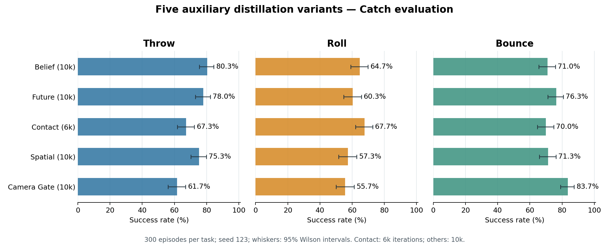

# 五组辅助蒸馏成功率分析（2026-10-29）

依据eval_export中的五份评估JSON，逐回合核验共4500条记录。原始文件未修改。

## 评估条件与口径

- 全部为Catch阶段visual_student，seed=123，每任务300回合且complete=true。
- Top/Wrist双深度相机，均为160×160，深度范围及EGL后端字段一致。
- Throw取success/throw_official；Roll取roll_eval_success/region_retention_v5；
  Bounce取success/bounce_catch_proximity_v2。不能用Roll原success或truncated替代。
- 四份文件名标注10000轮，Contact文件名标注6000轮，Contact属于预算不同的中间结果。
- 导出文件不含checkpoint迭代/哈希、完整训练配置或resume_audit，无法独立确认best/last选择、
  训练并行数、完整采样预算及恢复中接受的源码变动。下述排名是当前导出结果排名。

## 主成功率

| 模型 | 文件标注轮次 | Throw | Roll | Bounce | 三任务均值 | 最低任务 | 成功总数 |
|---|---:|---:|---:|---:|---:|---:|---:|
| C2 belief | 10000 | 80.33% | 64.67% | 71.00% | 72.00% | 64.67% | 648/900 |
| C1 future | 10000 | 78.00% | 60.33% | 76.33% | 71.56% | 60.33% | 644/900 |
| C4 contact | 6000 | 67.33% | 67.67% | 70.00% | 68.33% | 67.33% | 615/900 |
| C3 spatial | 10000 | 75.33% | 57.33% | 71.33% | 68.00% | 57.33% | 612/900 |
| C5 camera_gate | 10000 | 61.67% | 55.67% | 83.67% | 67.00% | 55.67% | 603/900 |

各任务回合数相同，所以三任务均值也等于成功总数/900；未混合不同成功定义计算逐任务指标。

## 结果解释

1. Belief均值72.00%，Future为71.56%，只差4/900个成功（0.44个百分点），应视为接近。
   Belief的Throw为80.33%、Roll为64.67%；Future的Bounce为76.33%，比Belief高5.33个百分点。
2. Contact仅6000轮，但Roll达67.67%，是本组最高；三任务最低值67.33%，也是本组最高。
   三任务极差只有2.67个百分点，属于最均衡的当前结果；不能据此保证续训到10000一定上升。
3. Camera gate的Bounce达到83.67%，本组最高，但Throw61.67%、Roll55.67%，均值67.00%。
   高Bounce表现与另外两任务的损失并存，不能将该模块称为全面提升。
4. Spatial均值68.00%，本次没有超过Belief/Future，Roll57.33%是其主要短板。
5. 除Contact外，四组最低任务均为Roll；多任务效果的主要短板仍在Roll。

## 单任务95% Wilson区间

以下直接使用原JSON中的区间，不将它们当作训练多seed稳定性估计。

| 模型 | Throw | Roll | Bounce |
|---|---:|---:|---:|
| belief | 75.5～84.4% | 59.1～69.9% | 65.6～75.8% |
| future | 73.0～82.3% | 54.7～65.7% | 71.2～80.8% |
| contact | 61.8～72.4% | 62.2～72.7% | 64.6～74.9% |
| spatial | 70.2～79.9% | 51.7～62.8% | 66.0～76.2% |
| camera_gate | 56.1～67.0% | 50.0～61.2% | 79.1～87.4% |

单任务只有300回合，若干个百分点的差距仍存在采样不确定性。
原worker每回合显式重设seed，回合长度和步内随机数消耗本身不会造成后续reset采样序列漂移；此前将它们列为不能配对的直接原因需要更正。
旧导出没有初始状态记录，且仍需核对源码和环境构造参数，不应仅按记录序号认定严格配对。新的1500回合多种子评估已记录并核验初始状态，详见[新报告](../../analysis_artifacts/distill_best_multiseed_20261029_v1/report/REPORT.md)。

## Roll保持质量

| 模型 | 曾进入区域保持状态 | 主成功 | 原环境success | 低速稳定保持roll_stable_hold |
|---|---:|---:|---:|---:|
| belief | 261/300 | 194/300 | 0/300 | 0/300 |
| future | 277/300 | 181/300 | 0/300 | 0/300 |
| contact | 282/300 | 203/300 | 0/300 | 0/300 |
| spatial | 276/300 | 172/300 | 0/300 | 0/300 |
| camera_gate | 271/300 | 167/300 | 0/300 | 0/300 |

- 五组roll_stable_hold均为0，原环境success也均为0；主成功标志不是这两个标志。
- 当前区域保持口径允许已有接触启动保持、随后无持续接触但球仍在手附近；主成功不要求低瞬时相对速度。
- 本地对应实现将低速稳定保持作为单独诊断，使用低相对速度、接触/短间断及持续时间条件。
  JSON未附服务器源码哈希，因此正式报告前仍应核对实际源码及视频，不根据单个标志断言物理抓握质量。
- 本组所有Roll主成功都以timeout结束，符合末端区域保持的统计方式；timeout本身不能算成功。
- 例如Contact的truncated率是81.00%，主成功为67.67%，不能把前者报告成抓取成功率。
- Camera gate曾进入保持状态271/300，主成功仅167/300；Spatial为276/300→172/300。
  这些计数提示需要关注接触后的保持/丢失，而不仅是能否接近球。

## 下一步

1. 先将Contact续训到10000，再与同预算模型比较；最好另保留各模型6000轮结果作横向对照。
2. 综合方向优先复验Belief与Future，均衡/最差任务方向优先复验Contact。
3. 用同预算B6位置辅助基线、相同评价口径和多个训练seed验证模块收益；本目录没有B0/B6/教师对照。
4. 单独评估Roll的区域保持、低速稳定保持及视频表现，保留原指标，不为得到更高成功率临时改阈值。

## 原始来源

- [belief_eval_010000.json](../belief_eval_010000.json)，SHA256：`95f96c386717b88246b96d53292b256270e3f938e4175df6f1f058497cbc6658`。
- [future_eval_010000.json](../future_eval_010000.json)，SHA256：`3b3ee3e92f2105747015aff82a079c791529c37d39b43d8d053d5906ae6fe0e5`。
- [contact_eval_006000.json](../contact_eval_006000.json)，SHA256：`57c2571c3cc7f4742eb7cc8f18b19d785f12a21177c90776de3bd9482e0e4d68`。
- [spatial_eval_010000.json](../spatial_eval_010000.json)，SHA256：`038a343788d5184272d4a8c2df4eb5c402fa4f74e5eb0e61dfc9a8528053898f`。
- [camera_gate_eval_010000.json](../camera_gate_eval_010000.json)，SHA256：`07ec4568dbb92723e3545ebe506cff9c3f48a405cb949b642cf79f0d992023c6`。

结构化汇总：`summary.json`；重新生成：在dcmm环境运行本目录`analyze.py`。
